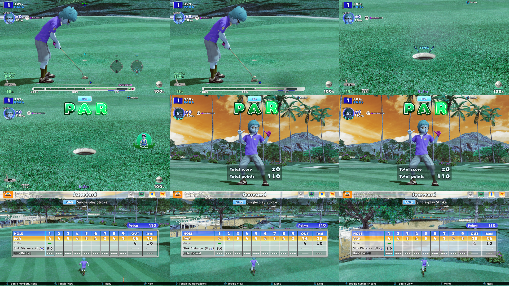

# Everybody's Golf PS4 PC Port

A work-in-progress native Windows x86-64 port of Everybody's Golf for PS4 (CUSA04687, update 1.17; sold as "Hot Shots Golf" in earlier US releases).

The port runs the game's original x86-64 code directly on Windows. The PS4 system libraries it calls are reimplemented in a runtime, and GPU commands are meant to be drawn with Vulkan. The runtime is a fork of [resogun-recomp](https://github.com/rcostanza/resogun-recomp). It lives in `external/resogun-recomp` as a git submodule, on the `everybodys-golf` branch of [finalpantasy/resogun-recomp](https://github.com/finalpantasy/resogun-recomp).

**No game files are included in this repository.**

## Current status

**Playable.** On 2026-11-18 a full 9-hole round was played by hand, start to finish, with keyboard controls. Shots, putts, scoring and the scorecard work.




What works:

- Boot, title screen, menus, the home island and character creation.
- Courses load and draw with correct colors. Hole scores register and read back after a restart.
- Stereo music and sound effects.
- 60 FPS in free roam, at the tee and during shots (the game's own PS4 Pro frame rate mode, held on in every scene; `frame_rate_priority=0` in settings.ini turns it off).
- Texture packs: dump the game's textures, upscale them, and the port draws the upscaled copies instead ([docs/texture-packs.md](docs/texture-packs.md)). Packs are made from your own copy and never shipped.
- A local PSN account stands in for sign-in, and 31 add-on entitlements are reported as installed.
- With the bundled local server, the daily ranking opens and a Game Room can be created up to its participant list.

Known problems:

- Course loads are slow. A repeat load of Eagle City took 40 to 60 seconds in one test (90 to 140 before); a course not loaded before takes longer, and some pipelines still recompile on every load.
- Above 1800 lines of render height, the course flyover drops below 60 FPS (34 to 49 FPS measured at 2160).
- Whether the game shows the add-on items is not verified.

Progress is measured by these steps: prepared image, boot, guest rendering, real menu, first playable hole, representative playthrough. The first five are reached.

## Goals

- Built-in DLC unlocked by default, with an original-entitlement test mode.
- Online multiplayer through a community server and a compatible peer transport.
- Restored limited-event gear, based on evidence of the original event, redemption and shop behavior.
- Higher frame rates and resolutions on PC.

The entitlement unlock is implemented and not yet verified in the game. Online play works in part against a local server only. Event gear is not implemented.

## What you need

- Your own legally dumped base game (CUSA04687).
- The 1.17 update.
- Your own DLC packages.

Packages, keys, licenses and game data stay out of the repository. See `.gitignore`.

## Install (Windows)

1. Run `EverybodysGolfPC-Setup-<version>.exe`. It installs for your user only and needs no admin rights. The default folder is `C:\Games\Everybody's Golf PC`; any folder you can write to works.
2. Start Everybody's Golf from the Start menu. On the Game files tab, choose your base game folder, the 1.17 update folder (leave it empty if your dump already has the update) and any DLC folders, then press Set up game files. It takes a few seconds.
3. Press Play.

Settings, saves, logs and the prepared game stay in `data\` inside the install folder, never in AppData. The installer adds only a Start menu shortcut and an uninstall entry for your user. Uninstalling keeps `data\` unless you say otherwise.

The launcher also has:

- Display: window mode, output resolution, render height, frame rate priority, SMAA, FSR 1 sharpening, vsync and HDR.
- HD textures: tick "Collect textures while playing", play a while, then build an upscaled pack with Real-ESRGAN (2x or 4x, bundled) and turn it on. The pack is made from your own copy and stays on your PC.

## Build

Clone with the runtime submodule:

```bash
git clone --recurse-submodules https://github.com/finalpantasy/everybodys-golf-ps4-pc-port.git
```

Requires Windows and MSYS2 with the CLANG64 environment. From `external/resogun-recomp`, in a CLANG64 shell:

```bash
bash build.sh
```

## Run

Run from the repository root. The runner looks for MSYS2 in `MSYS2_ROOT`, then `tools/msys2/msys64`, then `C:\msys64`.

Check the prepared game files:

```bash
python external/resogun-recomp/run.py check --game work/game-1.17 --out work/game-1.17-prepared --any-build
```

Stage your dump into `work/game-1.17` first with `tools/stage_game.py`. Then play:

```bash
python external/resogun-recomp/run.py play --game work/game-1.17 --out work/game-1.17-prepared --any-build
```

The runner opens a borderless window that covers the screen. Set `RESOGUN_DISPLAY_MODE=windowed` for a normal window. Add `--timeout 20` for a bounded test boot.

Keyboard: Space or Enter is Cross, Esc is Circle, the arrow keys are the d-pad, WASD is the left stick and Tab is Options. A controller works too.

Current state, evidence and the next step are in [docs/STATE.md](docs/STATE.md).

## Release standards

Releases will follow these rules. The current tree does not meet them yet; the gap list is in [docs/research/release-standards-gap.md](docs/research/release-standards-gap.md).

- One executable.
- Portable by default.
- A tarball next to any AppImage.
- A command-line flag for every option.

## Credits and license

Licensed under the GNU General Public License, version 2, the same license as the upstream project. The upstream `LICENSE` is kept unchanged.

- [resogun-recomp](https://github.com/rcostanza/resogun-recomp) by rcostanza: the runtime this port is forked from.
- driveclub-recomp: a reference for the same approach.
- shadPS4: a reference for PS4 system behavior.

This is an unofficial project and is not affiliated with Sony or the game's developers.
