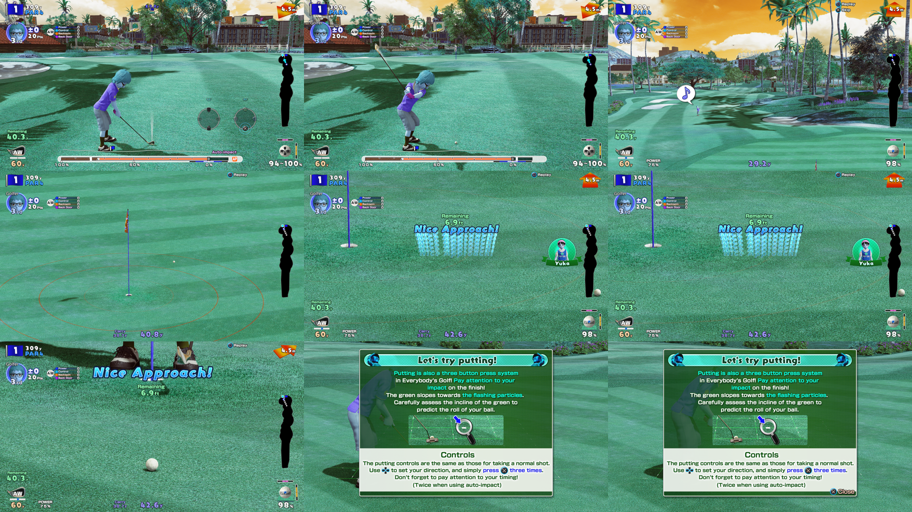

# Everybody's Golf PS4 PC Port

A work-in-progress native Windows x86-64 port of Everybody's Golf for PS4 (CUSA04687, update 1.17; sold as "Hot Shots Golf" in earlier US releases).

The port runs the game's original x86-64 code directly on Windows. The PS4 system libraries it calls are reimplemented in a runtime, and GPU commands are meant to be drawn with Vulkan. The runtime is a fork of [resogun-recomp](https://github.com/rcostanza/resogun-recomp). It lives in `external/resogun-recomp` as a git submodule, on the `everybodys-golf` branch of [finalpantasy/resogun-recomp](https://github.com/finalpantasy/resogun-recomp).

**No game files are included in this repository.**

## Current status

**Playable.** On 2026-11-18 a full 9-hole round was played by hand, start to finish, with keyboard controls. Shots, putts, scoring and the scorecard work.




What works:

- Boot, title screen, menus, the home island and character creation.
- Courses load and draw with correct colors. Hole scores register and read back after a restart.
- Stereo music and sound effects.
- 60 FPS in free roam, at the tee and during shots (the game's own PS4 Pro frame rate mode, held on in every scene; `frame_rate_priority=0` in settings.ini turns it off).
- Texture packs: dump the game's textures, upscale them, and the port draws the upscaled copies instead ([docs/texture-packs.md](docs/texture-packs.md)). Packs are made from your own copy and never shipped.
- A local PSN account stands in for sign-in, and 31 add-on entitlements are reported as installed. Add-on outfits show in Customize Character with a DLC badge (kigurumi sets, polo shirts, accessories).
- Online play with friends: one player presses Host a game on the launcher's Online tab and sends the invite code; the others paste it and join. Players show up in the same Open Course lobby, each with their own golfer and name. Games on your home network show up in a list, and the launcher opens the router port with UPnP.
- Trophies: all 31 have their real names and grades, a popup shows when one unlocks, and the Trophies tab lists them per save.
- Render resolution changes while you play (tested on the island: 1080 to 1440 and back, with no restart).

Known problems:

- Course loads are slow. A repeat load of Eagle City took 40 to 60 seconds in one test (90 to 140 before); a course not loaded before takes longer, and some pipelines still recompile on every load.
- Above 1800 lines of render height, the course flyover drops below 60 FPS (34 to 49 FPS measured at 2160).
- Add-on courses, clubs, balls, carts and caddies are not checked yet.
- Online play is tested with two copies of the game on one PC, joined by invite code through the router, including with 80 ms of added lag. Play between two homes and a full round together are not tested yet. Reports are welcome.

Progress is measured by these steps: prepared image, boot, guest rendering, real menu, first playable hole, representative playthrough. The first five are reached.

## Goals

- Built-in DLC unlocked by default, with an original-entitlement test mode.
- Online multiplayer through a community server and a compatible peer transport.
- Restored limited-event gear, based on evidence of the original event, redemption and shop behavior.
- Higher frame rates and resolutions on PC.

The entitlement unlock is implemented and not yet verified in the game. Online play works in part: the host's PC runs the server and relays the game's traffic, so players meet in the same Open Course lobby; a full round together is not tested yet. Event gear is not implemented.

## What you need

- Your own legally dumped base game (CUSA04687).
- The 1.17 update.
- Your own DLC packages.

Packages, keys, licenses and game data stay out of the repository. See `.gitignore`.

## Download and install (Windows)

**[Download the latest release](https://github.com/finalpantasy/everybodys-golf-ps4-pc-port/releases/latest)** (`everybodys-golf-pc-<version>-windows-x64.zip`).

1. Unpack the whole zip into a folder of its own. Any folder you can write to works; no admin rights are needed.
2. Start `EverybodysGolf.exe`. The first time, it opens on Game files. Choose your base game folder, the 1.17 update folder (leave it empty if your dump already has the update) and any DLC folders, then press Set up game files. It takes a few seconds and only reads your dump.
3. Press Play.


### Updates

Once a day at most, the launcher asks GitHub for a newer release. When there is one, it shows the release notes and offers Update now, Later or Skip this version. Update now downloads the new zip, checks it against its SHA-256 file, replaces only the program files and restarts. Saves, settings and the prepared game in `data\` are kept, and a failed update puts the previous version back. Turn the check off on the Play tab.


Settings, saves, logs and the prepared game stay in `data\` inside the install folder, never in AppData. To remove everything, delete the folder.

The launcher also has:

- Display: window mode, output resolution, render resolution, 60 FPS mode, SMAA, FSR 1 sharpening, vsync and HDR.
- Saves: several saves, each with its own golfer and progress. Make a new one, copy, rename, back up to `data\backups`, or move one to the Recycle Bin.
- HD textures: tick "Collect textures while playing", play a while, then build an upscaled pack with Real-ESRGAN (2x or 4x, bundled) and turn it on. The pack is made from your own copy and stays on your PC.
- Trophies: every trophy of the selected save, with its grade and the time it was earned.
- Online: press Host a game, then Copy, and send the invite code (four groups of four letters and digits) to your friends. They paste it into Join (on the same home network, Find games on my network lists the host instead). Everyone presses Play, then picks Online > Open Course in the game. All game traffic passes through the host's PC, so only the host needs an open port: "Open the port on my router" asks the router with UPnP or NAT-PMP. If the router refuses, forward TCP port 48765 to the host's PC by hand, or have everyone join one VPN such as Tailscale. Step by step, with fixes for connection problems: [docs/multiplayer.md](docs/multiplayer.md). With Online set to Off the game starts signed out and plays offline.


### Settings in the game

Press F10 in the game. On a controller, hold Options for 2 seconds. Display Settings opens over the game. These change at once: window mode, window size, monitor, vsync, render resolution (up to 1800 lines, or the size the game started at if higher), SMAA, sharpening and HD textures. 60 FPS mode and HDR take effect at the next start. The launcher and the game share one settings file, so a change in either shows in the other.

## Build

Clone with the runtime submodule:

```bash
git clone --recurse-submodules https://github.com/finalpantasy/everybodys-golf-ps4-pc-port.git
```

Requires Windows and MSYS2 with the CLANG64 environment. From `external/resogun-recomp`, in a CLANG64 shell:

```bash
bash build.sh
```

## Run

Run from the repository root. The runner looks for MSYS2 in `MSYS2_ROOT`, then `tools/msys2/msys64`, then `C:\msys64`.

Check the prepared game files:

```bash
python external/resogun-recomp/run.py check --game work/game-1.17 --out work/game-1.17-prepared --any-build
```

Stage your dump into `work/game-1.17` first with `tools/stage_game.py`. Then play:

```bash
python external/resogun-recomp/run.py play --game work/game-1.17 --out work/game-1.17-prepared --any-build
```

The runner opens a borderless window that covers the screen. Set `RESOGUN_DISPLAY_MODE=windowed` for a normal window. Add `--timeout 20` for a bounded test boot.

Keyboard: Space or Enter is Cross, Esc is Circle, the arrow keys are the d-pad, WASD is the left stick and Tab is Options. A controller works too.

Current state, evidence and the next step are in [docs/STATE.md](docs/STATE.md).

## Release standards

Releases will follow these rules. The current tree does not meet them yet; the gap list is in [docs/research/release-standards-gap.md](docs/research/release-standards-gap.md).

- One executable.
- Portable by default.
- A tarball next to any AppImage.
- A command-line flag for every option.

## Credits and license

Licensed under the GNU General Public License, version 2, the same license as the upstream project. The upstream `LICENSE` is kept unchanged.

- [resogun-recomp](https://github.com/rcostanza/resogun-recomp) by rcostanza: the runtime this port is forked from.
- driveclub-recomp: a reference for the same approach.
- shadPS4: a reference for PS4 system behavior.

This is an unofficial project and is not affiliated with Sony or the game's developers.
